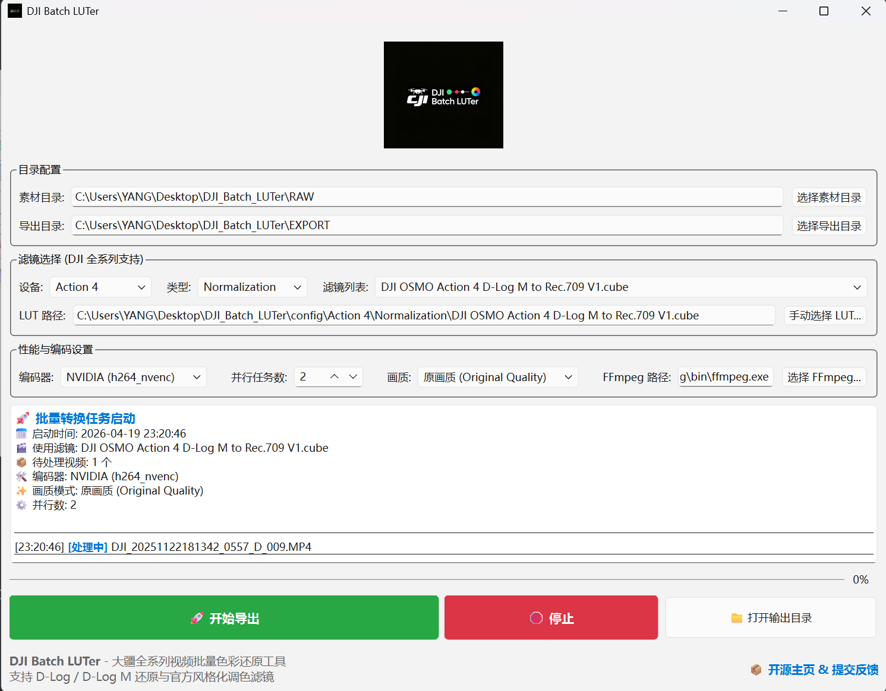
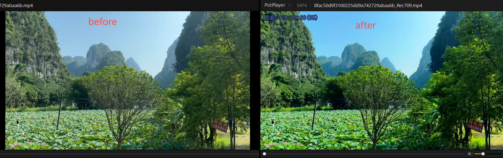

<h1 align="center">🎬 DJI Batch LUTer</h1>

<p align="center"><b>大疆 (DJI) 全系列视频批量调色工具</b></p>

<p align="center">把 Action / Pocket / Mavic 等系列录制的 D-Log / D-Log M 灰片素材，通过官方 LUT 一键还原为标准 Rec.709 色彩；<br>支持套用官方调色滤镜、显卡加速、批量并行导出。</p>

<p align="center">
<a href="#-核心功能">核心功能</a> ·
<a href="#-支持列表">支持列表</a> ·
<a href="#-项目结构">项目结构</a> ·
<a href="#-快速开始-开发者从源码运行">快速开始</a> ·
<a href="#-使用说明">使用说明</a> ·
<a href="#-导出参数">导出参数</a> ·
<a href="#-ffmpeg-下载源">FFmpeg 下载源</a>
</p>

<p align="center"></p>

<p align="center"><b>效果预览</b>：D-Log M 素材还原前后对比（左：还原前，右：还原后）</p>

<p align="center"></p>

---

## 🌟 核心功能

- **自动批量处理**: Action / Pocket / Mavic 等全系列素材，D-Log / D-Log M 一键还原为标准 Rec.709 色彩。
- **官方调色滤镜**: 内置 DJI 官方风格化滤镜（Forest、Ice、Nature 等），按设备与类型自动归类；选中时下方会显示该滤镜的效果说明。
- **极速硬件加速**: 支持 NVIDIA / Intel / AMD 显卡加速导出；驱动不支持或编码失败时自动回退 CPU，音轨无法封装时自动转 AAC，全程无需人工干预。
- **并行批量转换**: 多个视频同时处理，充分利用硬件性能。
- **内置 FFmpeg 一键下载**: 不用自己找 FFmpeg，点界面按钮即可国内镜像加速下载（带进度条、可取消），也不占用发布包体积。

## 📋 支持列表

| 设备系列                  | 还原滤镜 (Normalization) | 调色滤镜 (Color Grading) | 说明                        |
| :-------------------- | :-------------------- | :-------------------- | :------------------------ |
| **Osmo Action 4**     | ✅ D-Log M to Rec.709  | ✅ Forest, Ice, Nature  | 🎨 全系列官方调色支持              |
| **Osmo Action 5 Pro** | ✅ D-Log M to Rec.709  | ✅ Ju, Lan, Mei, Zhu    | ✨ 最新 Pro 系列滤镜支持           |
| **Osmo Action 6**     | ✅ D-Log M to Rec.709  | —                     | 🚀 新增 Action 6 适配          |
| **Osmo Pocket 3**     | ✅ D-Log M to Rec.709  | ✅ Spring, Summer...    | 🌸 包含四季风格调色                |
| **Osmo Pocket 4**     | ✅ D-Log to Rec.709    | —                     | 🎞️ 包含标准及 Vivid 还原         |
| **Osmo Pocket 6**     | ⏳ 待补充滤镜文件             | —                     | 📂 放入 `config/Pocket 6/` 即可 |
| **Mavic 3 系列**        | ✅ D-Log, D-Log M       | —                     | 🛸 包含标准及 Vivid 还原         |
| **Mavic 4 Pro**       | ✅ D-Log, D-Log M       | —                     | 🚁 包含标准及 Vivid 还原         |
| **其他设备**              | 自动识别子目录               | 自动识别子目录               | 📂 支持通过 `config/` 目录扩展     |

### 滤镜效果说明

滤镜名称不带效果描述，选中后界面下方会显示对应提示（文案取自 `config/lut_descriptions.json`，可自行修改）。

**还原滤镜（Normalization）** —— 把灰片还原成可正常观看的色彩：

| 滤镜 | 效果 |
| :--- | :--- |
| `D-Log M / D-Log → Rec.709` | 标准还原：色彩中性，作为后续调色的起点 |
| `… → Rec.709 Vivid` | 鲜艳版：提高饱和度与对比度，画面更通透，出片直发 |

**调色滤镜（Color Grading）** —— 在还原基础上套用官方风格，出片即成品：

| 滤镜 | 效果 |
| :--- | :--- |
| 🌲 **Forest** | 森林：浓郁自然、偏青绿，适合山林植被等户外场景 |
| 🧊 **Ice** | 冰蓝：冷调清透，适合雪景、水面与冷色场景 |
| 🌿 **Nature** | 自然：通透清新，接近肉眼观感 |
| 🎋 **Ju / Lan / Mei / Zhu** | 梅兰竹菊：四款中式氛围感滤镜，建议先用小段素材试套 |
| 🌸 **Spring / Summer / Autumn / Winter** | 四季：春 清透明亮偏嫩绿 · 夏 明亮高饱和 · 秋 暖调金黄 · 冬 冷调低饱和 |

## 📂 项目结构

```text
DJI/
├── config/               # 存放 DJI 官方及自定义 LUT 文件 (*.cube)
│   ├── lut_descriptions.json # 滤镜效果提示文案 (可自定义)
│   ├── Action 4/         # 按设备系列分类
│   │   ├── Normalization/ # 还原滤镜 (如 D-Log M to Rec.709)
│   │   └── Color Grading/ # 调色滤镜
│   ├── Action 5 Pro/
│   └── Mavic 3/          # 其他设备系列...
├── doc/                  # 项目说明文档
│   ├── QA.md             # 硬件加速常见问题 (Q&A)
│   └── packaging.md      # 项目打包指南
├── src/
│   ├── DJI_Batch_LUTer.py # 图形界面主程序
│   ├── setup_ffmpeg.py    # FFmpeg 下载/配置模块 (界面按钮与命令行共用)
│   ├── build.py           # 一键打包脚本
│   └── assets/            # 程序图标及 Logo 资源
├── ffmpeg/               # 【运行时自动生成】下载后的 FFmpeg (不随仓库/发布包分发)
│   └── bin/ffmpeg.exe
├── RAW/                  # 默认原始素材存放目录
├── EXPORT/               # 默认导出视频存放目录
├── dev.bat               # 一键脚本: 运行 / 打包 / 打包并运行 (Windows)
├── .gitattributes        # 锁定批处理文件换行为 CRLF
├── README.md             # 项目说明文档
├── requirements.txt      # Python 依赖包列表
├── config.example.json   # 配置文件模板
└── dji_luter_config.json # 自动生成的配置文件 (记住用户设置)
```

## 📖 详细文档

更多关于本工具的使用细节，请参阅：
- [硬件加速常见问题 (Q&A)](doc/QA.md)
- [项目打包指南](doc/packaging.md)

## 🚀 快速开始 (开发者/从源码运行)

如果你是开发者或希望从源码运行，请遵循以下步骤（需要 Python 3.13.3+）：

### 1. 克隆项目 (Clone)
```bash
git clone https://github.com/tianwen42/DJI_Batch_LUTer.git
cd DJI_Batch_LUTer
```

### 2. 安装依赖 (Install)
```bash
pip install -r requirements.txt
```

### 3. 初始化 FFmpeg (可选)

程序启动会自动检测 FFmpeg。缺失时点界面上的「下载 FFmpeg」按钮即可，也可提前用命令行下载（约 20MB，国内镜像，见下文「FFmpeg 下载源」）：

```bash
python src/setup_ffmpeg.py
```

### 4. 运行或打包 (Run/Build)

- **一键脚本 (Windows 推荐)**: 双击根目录的 `dev.bat`，按菜单序号选择：
  - `[1]` 运行程序（源码启动，不打包）
  - `[2]` 打包「目录模式」→ `dist/`（**启动快，推荐**）
  - `[3]` 打包「目录模式」并立即运行
  - `[4]` 打包「单文件 EXE」（启动慢，便于携带）

  脚本会自动定位 Python（`.venv` → `venv` → PATH），缺 PyQt6 时自动补装。

- **手动运行**: `python src/DJI_Batch_LUTer.py`
- **手动打包**: `python src/build.py`（目录模式）/ `python src/build.py --onefile`（单文件）

**两种打包模式怎么选：**

| 模式 | 产物 | 启动 | 适用场景 |
| :--- | :--- | :--- | :--- |
| **目录模式**（默认） | `dist/`（整个文件夹即完整项目） | **快**，直接加载无需解压 | 自己用、发给同事 |
| 单文件 `--onefile` | `dist/DJI_Batch_LUTer.exe` | 慢，每次启动都要解压约 38MB 到 `%TEMP%` | 只想发一个文件 |

打包完成后 **`dist/` 本身就是可直接运行的完整项目**，没有多余的一层子目录：

```text
dist/
├── DJI_Batch_LUTer.exe   # 双击运行
├── _internal/            # 运行时依赖（目录模式）
├── config/               # 滤镜库 + 说明
├── doc/                  # 文档
├── RAW/                  # 素材目录
├── EXPORT/               # 导出目录
└── dji_luter_config.json # 用户设置
```

> 🔒 **重新打包不丢数据**：`RAW/`、`EXPORT/` 和 `dji_luter_config.json` 原样保留，`config/`、`doc/` 每次刷新为最新。

> ⚡ **两种模式产物都在 `dist/DJI_Batch_LUTer.exe`**，重新打包整体替换 `dist/`；启动已优化为「界面先出、编码器随后自动选好」，嫌慢优先用目录模式。

> ⚠️ 打包前先关闭正在运行的程序；`dev.bat` 保持 CRLF（`.gitattributes` 已锁定）。

## 🛠️ 使用说明

1. **选择素材**: 将视频放入 `RAW` 目录，或点击按钮手动选择目录。
2. **选择设备与滤镜**:
   - 在“设备”下拉框选择你的相机型号（如 Action 5 Pro）。
   - 在“类型”下拉框选择“还原”或“调色”。
   - 在“滤镜列表”中选择具体的滤镜文件，选框下方会显示**该滤镜的效果提示**（文案取自 `config/lut_descriptions.json`，可自行修改）。
   - 也支持点击“手动选择 LUT”来加载任何外部 `.cube` 文件。
3. **设置并发**: 建议显卡加速时设为 3-7，纯 CPU 模式可设为 CPU 核心数。
4. **开始导出**: 点击按钮，等待进度条走完。

## ⚖️ 导出参数
- **视频编码**: H.264
- **画质档位** (界面"画质"下拉框):

  | 档位 | 硬件编码 (固定码率) | CPU 编码 (CRF / preset) |
  | :--- | :--- | :--- |
  | 原画质 (默认) | 150 Mbps | CRF 14 (`slow`) |
  | 高质量 | 80 Mbps | CRF 16 (`medium`) |
  | 标准 | 40 Mbps | CRF 20 (`medium`) |
  | 极速 | 15 Mbps | CRF 24 (`ultrafast`) |

- **音频**: 优先原始音轨无损复制 (Copy)；若音轨无法封装进 MP4 (例如 MOV 里的 PCM)，自动改用 AAC 192kbps 重编码
- **像素格式**: 先应用 LUT（FFmpeg 会自动升到 16-bit RGB 做插值），最后统一转为 8-bit 4:2:0 以保证兼容性
- **失败自动降级**: 硬件编码失败时无需人工干预，自动回退 CPU 编码重试

## ⬇️ FFmpeg 下载源

FFmpeg 不随项目/发布包分发，首次使用时按需下载（约 20MB），按以下顺序自动回退：

| 顺序 | 镜像源 | 地址 |
| :---: | :--- | :--- |
| 1 | 腾讯云 npm 镜像 | https://mirrors.cloud.tencent.com/npm/ |
| 2 | 华为云 npm 镜像 | https://mirrors.huaweicloud.com/repository/npm/ |
| 3 | 中科大 npm 镜像 | https://npmreg.proxy.ustclug.org/ |
| 4 | GitHub 直连（兜底） | https://github.com/GyanD/codexffmpeg/releases |

国内源为 npm 上的 `@ffmpeg-installer/win32-x64` 包，实测支持 `nvenc / qsv / amf / libx264 / libx265`，硬件加速不受影响。

安装位置固定为 **`<项目根目录>/ffmpeg/bin/ffmpeg.exe`**（打包运行时为 EXE 同级目录），下载完自动解压并填好路径；项目克隆到任何盘符/目录都会自动适配，也可用环境变量 `DJI_LUTER_HOME` 指定。增删镜像源只需编辑 `src/setup_ffmpeg.py` 顶部的 `FFMPEG_SOURCES`。

启动时按这个顺序查找 FFmpeg：**项目内部**（EXE 同级 `ffmpeg/bin` → 项目根 `ffmpeg/bin`）→ **配置里记录的路径** → **系统 PATH**。即项目内部没有才会去用系统里已装的 FFmpeg。

## ☕ 喝杯咖啡

如果您觉得这个工具对您有所帮助，欢迎赞助作者喝杯奶茶，您的支持是我持续更新的动力！


## 声明与致谢

### 项目声明
本工具仅作为视频处理辅助工具，不对处理后的视频质量做绝对保证。请在使用前备份好你的原始素材。

### 致谢
- **[FFmpeg](https://ffmpeg.org/)**: 感谢 FFmpeg 团队提供的强大开源视频处理引擎。本工具的核心处理逻辑完全基于 FFmpeg。
- **[DJI (大疆创新)](https://www.dji.com/)**: 感谢大疆提供的专业色彩科学及官方 D-Log M 还原滤镜。

---
*本项目与大疆创新官方无直接关联，仅为个人开发者为提升工作效率而制作。*

## 📝 注意事项
- 如果处理失败，请检查 FFmpeg 路径是否正确；若提示缺少 FFmpeg，点界面上的「下载 FFmpeg」按钮即可一键获取。
- 项目与发布包**均不含 FFmpeg**，首次使用需联网下载一次（约 20MB，之后会一直复用）。
- 本工具已针对 10-bit 素材做了 8-bit 编码兼容性优化。
- 建议定期将最新的官方 LUT 文件按设备/类型放入 `config/` 目录（例如 `config/Action 5 Pro/Normalization/`）以获得最佳支持。
- 我只有一个 DJI Action 4，其他系列文件未测试，请自行探索效果。

